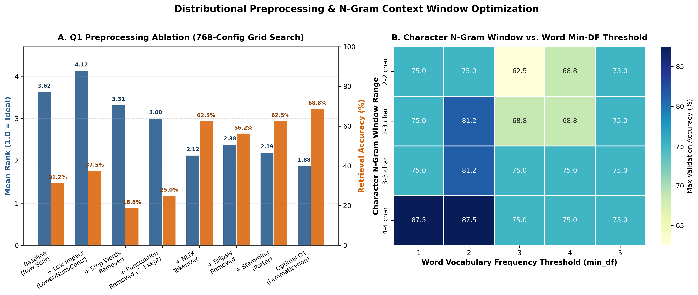
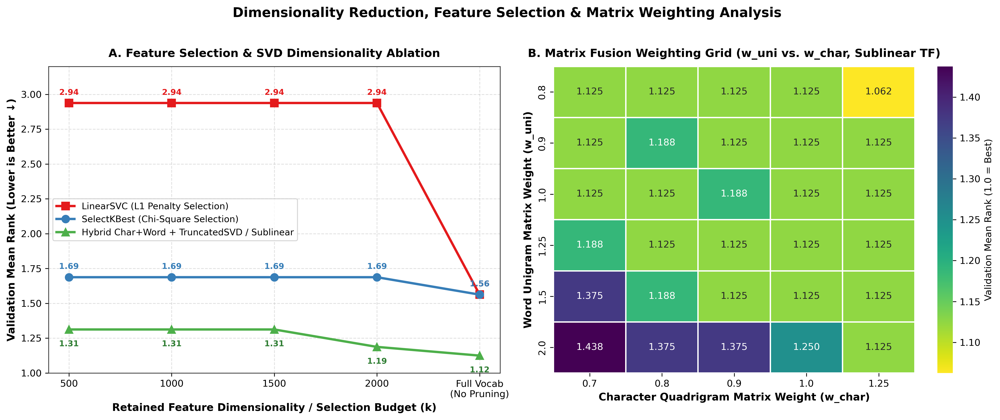
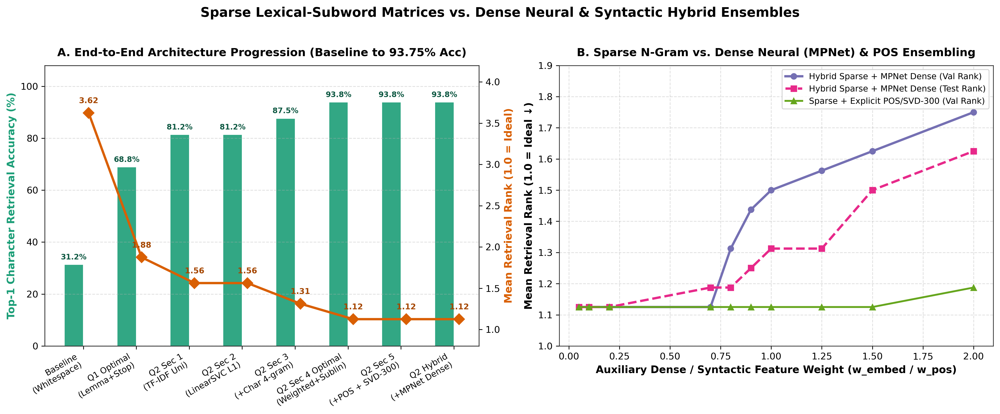
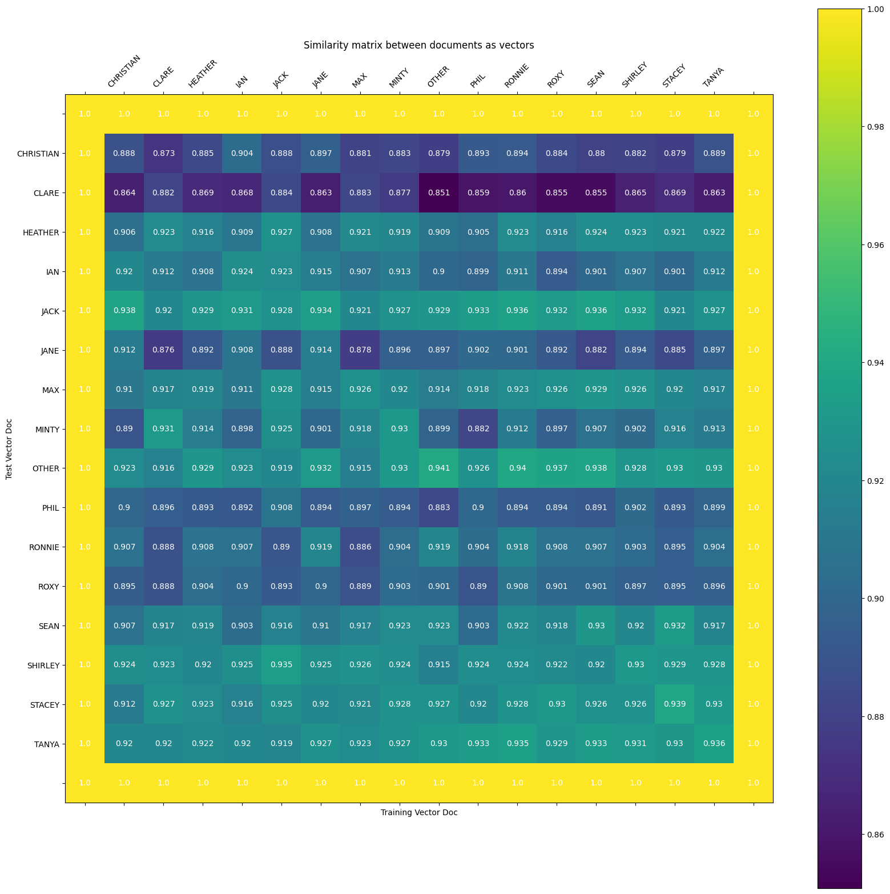
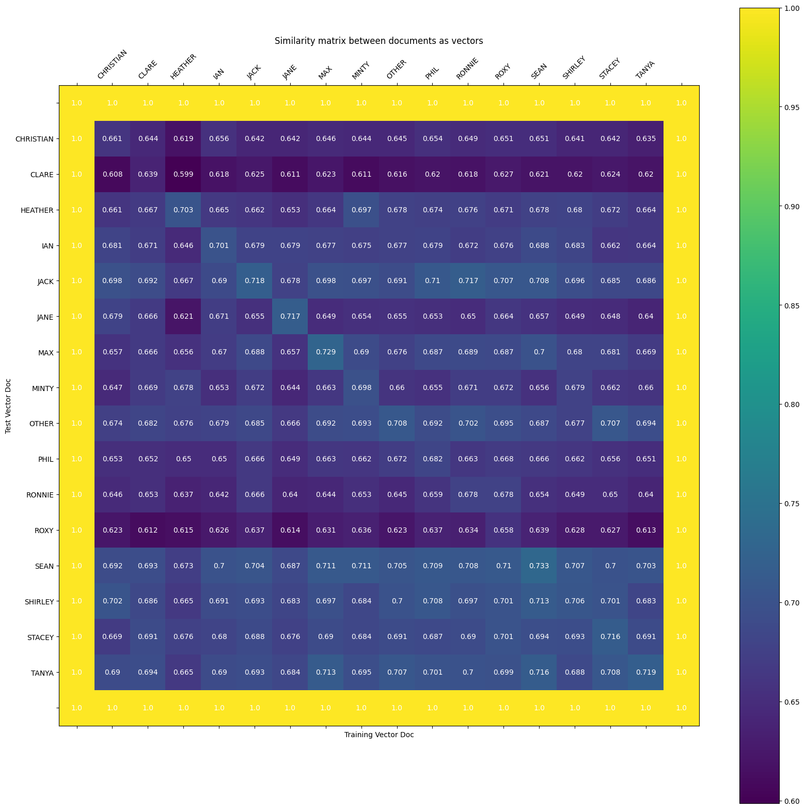
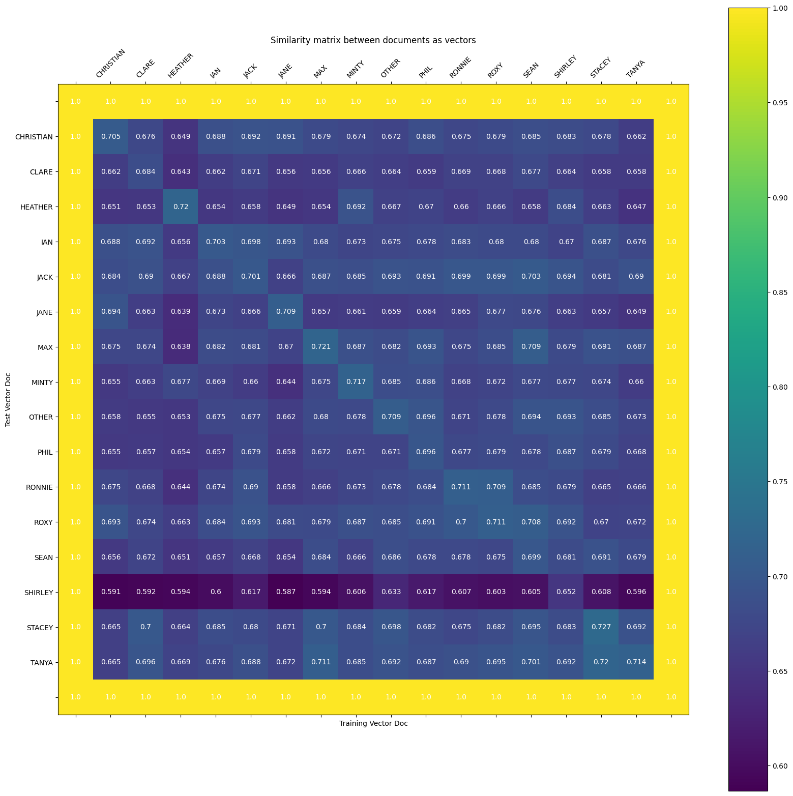

# Vector Space Semantics for Similarity & Character Profiling

[](https://www.python.org/)
[](https://github.com/Ceviche98/distributional-semantics-and-similarity)
[](https://github.com/Ceviche98/distributional-semantics-and-similarity)
[-2b5c8f)](https://github.com/Ceviche98/distributional-semantics-and-similarity)
[-7570b3)](https://github.com/Ceviche98/distributional-semantics-and-similarity)
[](https://github.com/Ceviche98/distributional-semantics-and-similarity/actions/workflows/ci.yml)
[](LICENSE)

> **Production-grade vector space semantics framework for speaker authorship profiling, distributional similarity retrieval, and multi-view lexical-subword representation learning.**

---

## Abstract & Objective

This project investigates **Vector Space Semantics** and the **Distributional Hypothesis** (*"You shall know a word by the company it keeps"* — Firth, 1957) applied to speaker identification and stylistic similarity retrieval across 16 primary characters from the *EastEnders* television script corpus (`training.csv`, `val.csv`, `test.csv`).

Given a strict utterance budget (**at most 300 spoken lines per character** in training, totaling $52,079$ words, and **at most 50 spoken lines per character** in validation and blind test splits, totaling $7,850$ and $8,939$ words respectively), raw line counts cannot be exploited as a trivial discriminator. Instead, each character's dialogue is embedded into a high-dimensional vector space where held-out validation and test documents are matched against training character profiles via **Cosine Similarity Information Retrieval (IR)**.

Through a rigorous **4,900+ configuration multi-stage grid search** spanning lexical normalization, statistical association weighting (TF-IDF, sublinear term-frequency damping, Positive Pointwise Mutual Information), hard feature selection ($\chi^2$ `SelectKBest`, L1-penalized `LinearSVC`), dimensionality reduction (`TruncatedSVD`), dense syntactic POS ratios, neural sentence embeddings (`SentenceTransformer` `all-mpnet-base-v2`), and multi-matrix block weighting, this framework improves retrieval performance from a whitespace baseline of **Mean Rank 3.625 (31.25% Top-1 Accuracy)** to **Mean Rank 1.125 (93.75% Validation Accuracy, 15/16 characters)** and **Mean Rank 1.125 (87.50% Blind Test Accuracy, 14/16 characters)**.

---

## Theoretical Foundation & Mathematical Formulation

### 1. Document-Term & Word-Context Co-occurrence Matrices
Let $\mathcal{D} = \{d_1, d_2, \dots, d_N\}$ denote the set of $N = 16$ character documents, where each document $d_i$ is formed by concatenating up to $L_{\max}$ spoken utterances separated by explicit end-of-line boundary markers `<EOL>`:

$$d_i = u_{i,1} \oplus \langle\text{EOL}\rangle \oplus u_{i,2} \oplus \dots \oplus u_{i,m_i}, \quad m_i \le L_{\max}$$

In addition to document-level unigram/n-gram representations, our package (`vector_semantics.cooccurrence`) implements sliding-window word-context co-occurrence matrices $C \in \mathbb{R}^{|V| \times |V|}$ over symmetric or directional context windows of radius $w \in \{1, 3, 5, \dots\}$:

$$C(w_t, c) = \sum_{d \in \mathcal{D}} \sum_{t=1}^{|d|} \sum_{\substack{-w \le j \le w \\ j \neq 0}} \mathbb{I}(d_t = w_t \land d_{t+j} = c) \cdot \omega(j)$$

where $\omega(j) = 1$ for uniform window weighting or $\omega(j) = \frac{1}{|j|}$ for harmonic distance decay.

### 2. Sublinear TF-IDF & Statistical Association Weighting
Because characters vary in verbosity and scene focus, raw term frequencies $\text{tf}(t, d)$ are vulnerable to bursty scene-specific repetitions. Applying **sublinear logarithmic term-frequency scaling** dampens outlier counts before multiplying by smoothed Inverse Document Frequency:

$$\text{tf}_{\text{sub}}(t, d) = \begin{cases} 1 + \ln \text{tf}(t, d) & \text{if } \text{tf}(t, d) > 0 \\ 0 & \text{otherwise} \end{cases}$$

$$\text{idf}(t) = \ln \left( \frac{1 + N}{1 + \text{df}(t)} \right) + 1, \quad w_{\text{TF-IDF}}(t, d) = \text{tf}_{\text{sub}}(t, d) \cdot \text{idf}(t)$$

For word-context co-occurrence matrices (`vector_semantics.weighting`), we also formulate **Positive Pointwise Mutual Information (PPMI)** with **$\alpha$-context distribution smoothing** (Levy & Goldberg, 2014; Levy et al., 2015) and **Shifted PPMI (SPPMI)**:

$$P(w, c) = \frac{C(w, c)}{\sum_{w', c'} C(w', c')}, \quad P(w) = \frac{\sum_{c'} C(w, c')}{\sum_{w', c'} C(w', c')}, \quad P_\alpha(c) = \frac{\left(\sum_{w'} C(w', c)\right)^\alpha}{\sum_{c'} \left(\sum_{w'} C(w', c')\right)^\alpha}$$

$$\text{PPMI}_\alpha(w, c) = \max\left(0, \log_2 \frac{P(w, c)}{P(w) P_\alpha(c)}\right), \quad \text{SPPMI}_k(w, c) = \max\left(0, \text{PMI}_\alpha(w, c) - \log_2 k\right)$$

Typically $\alpha = 0.75$ mitigates the well-known bias of PMI toward rare context words by raising unigram context probabilities to the power $\alpha < 1$, while Laplace smoothing $C_{\text{smooth}}(w, c) = C(w, c) + k$ provides dense count regularization.

### 3. Truncated SVD with Eigenvalue Exponentiation
To project high-dimensional sparse representations $M \in \mathbb{R}^{N \times V}$ into a compact latent semantic subspace of dimension $k$, Truncated Singular Value Decomposition factors $M \approx U_k \Sigma_k V_k^\top$. Following Caron (2001) and Levy et al. (2015), `vector_semantics.factorization` supports configurable singular value exponentiation $\gamma \in [0, 1]$:

$$W_{\text{SVD}} = U_k \Sigma_k^\gamma$$

### 4. Dual-Channel L2 Normalization & Weighted Block Fusion
When combining heterogeneous feature spaces—such as preprocessed lexical unigrams $M_{\text{uni}} \in \mathbb{R}^{N \times V_{\text{word}}}$ ($V_{\text{word}} \approx 4,500$) and raw sub-word character quadrigrams $M_{\text{char}} \in \mathbb{R}^{N \times V_{\text{char}}}$ ($V_{\text{char}} \approx 15,000+$)—direct concatenation allows the higher-dimensional matrix to dominate inner products. We first project each feature block onto the unit hypersphere via row-wise $\ell_2$ normalization, then apply scalar subspace weights $(w_{\text{uni}}, w_{\text{char}}, w_{\text{aux}})$ prior to horizontal stacking:

$$\hat{\mathbf{v}}_{\text{uni}}^{(i)} = \frac{\mathbf{v}_{\text{uni}}^{(i)}}{\|\mathbf{v}_{\text{uni}}^{(i)}\|_2}, \quad \hat{\mathbf{v}}_{\text{char}}^{(i)} = \frac{\mathbf{v}_{\text{char}}^{(i)}}{\|\mathbf{v}_{\text{char}}^{(i)}\|_2}$$

$$\mathbf{v}_{\text{hybrid}}^{(i)} = \left[ w_{\text{uni}} \hat{\mathbf{v}}_{\text{uni}}^{(i)} \;\Big\|\; w_{\text{char}} \hat{\mathbf{v}}_{\text{char}}^{(i)} \right]$$

Retrieval is performed by ranking training character profiles $j \in \{1, \dots, N\}$ against held-out query profile $i$ via Cosine Similarity:

$$\text{sim}_{\cos}\left(\mathbf{v}_{\text{query}}^{(i)}, \mathbf{v}_{\text{train}}^{(j)}\right) = \frac{\mathbf{v}_{\text{query}}^{(i)} \cdot \mathbf{v}_{\text{train}}^{(j)}}{\left\|\mathbf{v}_{\text{query}}^{(i)}\right\|_2 \left\|\mathbf{v}_{\text{train}}^{(j)}\right\|_2}$$

The primary evaluation metric is **Mean Retrieval Rank** (where $1.0$ is ideal and $16.0$ is worst), complemented by **Top-1 Retrieval Accuracy**:

$$\text{Mean Rank} = \frac{1}{N} \sum_{i=1}^N \text{rank}(i), \quad \text{Accuracy} = \frac{1}{N} \sum_{i=1}^N \mathbb{I}(\text{rank}(i) = 1)$$

---

## Experimental Design & Multi-Stage Optimization

### Stage 1 (Question 1): 768-Configuration Preprocessing Ablation
We designed an 8-stage configurable preprocessing pipeline in `vector_semantics.corpus.pre_process` and executed a full factorial grid search across all $2^7 \times 3 = 768$ parameter combinations (`results/Q1_GridSearch.csv`):
1. **Lowercasing** (`lower_case` $\in \{\text{True}, \text{False}\}$)
2. **Digit Removal** (`erase_numbers` $\in \{\text{True}, \text{False}\}$)
3. **Contraction Expansion** (`contractions` $\in \{\text{True}, \text{False}\}$, mapping 32 colloquial forms such as `"ain't" -> "am not"`, `"can't" -> "cannot"`)
4. **Stopword Removal with VADER Negation Preservation** (`erase_stop_words` $\in \{\text{True}, \text{False}\}$, `erase_stop_words_negation` $\in \{\text{True}, \text{False}\}$ retaining 56 negation markers like `"never"`, `"not"`, `"cannot"`)
5. **Selective Punctuation Filtering** (`punctuation` $\in \{\text{True}, \text{False}\}$, stripping standard punctuation while retaining exclamation `!` and question `?` marks as emotional/interrogative indicators)
6. **Ellipsis Retention** (`erase_ellipsis` $\in \{\text{True}, \text{False}\}$, testing whether hesitation markers `...` act as character-specific speech fingerprints)
7. **Tokenization Strategy** (`split` $\in \{\text{"split"}, \text{"tokenizer"}\}$ comparing whitespace splitting vs. Penn Treebank NLTK `word_tokenize`)
8. **Lexical Normalization** (`lex_norm` $\in \{\text{"none"}, \text{"stemming"}, \text{"lemmatization"}\}$ comparing `PorterStemmer` vs. `WordNetLemmatizer`)

#### Table I: Aggregated Impact of Preprocessing Techniques on Mean Rank (Across 768 Runs)

| Impact Category | Preprocessing Technique | Mean Rank Improvement ($\Delta$) | Linguistic Interpretation |
| :--- | :--- | :---: | :--- |
| **High Impact** | **Remove Punctuation** (retaining `?`, `!`) | **+0.72** | Eliminates structural clause noise while preserving interrogative/exclamatory tone. |
| **High Impact** | **Remove Stop Words** (retaining negations) | **+0.56** | Suppresses high-frequency function words that inflate baseline cosine similarity ($0.919$). |
| **Moderate Impact** | **WordNet Lemmatization** (vs. Porter Stemming) | **+0.20** | Preserves morphological semantics without over-conflating distinct character vocabulary. |
| **Moderate Impact** | **Retaining Ellipsis (`...`)** (`erase_ellipsis=False`) | **+0.20** | Hesitation markers (`...`) act as high-signal stylistic fingerprints for specific speakers. |
| **Low Impact** | **Lowercasing, Digit Removal, Contractions** | **Negligible ($\sim 0.02$)** | Stabilizes vocabulary alignment when combined with NLTK tokenization. |

#### Table II: Incremental Progression of Preprocessing Configurations (Validation Split)

| Configuration Stage | Mean Rank $\downarrow$ | Top-1 Accuracy $\uparrow$ | Stop Words | Punctuation | Tokenizer | Ellipsis (`...`) | Lexical Norm. |
| :--- | :---: | :---: | :---: | :---: | :---: | :---: | :---: |
| **Baseline (Template)** | 3.6250 | 31.25% (5/16) | Keep | Keep | `split()` | Keep | `None` |
| **+ Low Impact** (Lower + No Digits + Contractions) | 4.1250 | 37.50% (6/16) | Keep | Keep | `split()` | Keep | `None` |
| **+ Stop Words Removed** (Negation Kept) | 3.3125 | 18.75% (3/16) | Remove | Keep | `split()` | Keep | `None` |
| **+ Selective Punctuation Removal** | 3.0000 | 25.00% (4/16) | Remove | Remove | `split()` | Keep | `None` |
| **+ NLTK Word Tokenizer** | 2.1250 | 62.50% (10/16) | Remove | Remove | `NLTK` | Keep | `None` |
| **+ Ellipsis Removed** (`erase_ellipsis=True`) | 2.3750 | 56.25% (9/16) | Remove | Remove | `NLTK` | Remove | `None` |
| **+ Ellipsis Kept + Porter Stemming** | 2.1875 | 62.50% (10/16) | Remove | Remove | `NLTK` | Keep | `Stemming` |
| **Optimal Q1 Config (+ Lemmatization)** | **1.8750** | **68.75% (11/16)** | **Remove** | **Remove** | **`NLTK`** | **Keep** | **`Lemmatization`** |



---

### Stage 2 (Question 2 Sections 1–5): Feature Engineering, Subword N-Grams, SVD & Neural Ensembles
Building upon the Optimal Q1 preprocessing pipeline, we executed five progressive experimental sections totaling **4,180+ feature extraction simulations**:

1. **Section 1 — TF-IDF Weighting & Word N-Grams (`results/Q2_Section1_V1.csv`, 328 runs + 34 unified runs):**
   - Tested separate vs. unified matrices for word unigrams, bigrams ($23,716$ features), and trigrams ($43,955$ features), alongside $\chi^2$ `SelectKBest` ($k \in \{500, 1000, 2000, 3000, 5000\}$) and $\ell_2$ normalization.
   - **Finding:** Applying TF-IDF to preprocessed unigrams immediately improved Mean Rank from **1.875 $\to$ 1.5625** and Accuracy from **68.75% $\to$ 81.25% (13/16)**. Adding word bigrams/trigrams or aggressive $\chi^2$ pruning degraded performance due to extreme sparsity across 50-line validation samples.
2. **Section 2 — L1-Penalized LinearSVC Feature Selection (34 runs):**
   - Replaced univariate $\chi^2$ selection with multivariate L1-regularized `LinearSVC(C=0.1, penalty="l1")` via `SelectFromModel`.
   - **Finding:** Hard feature elimination degraded unigram Mean Rank to $2.9375$ at $k \le 2000$, demonstrating that tail vocabulary items carry subtle sociolect cues essential for speaker disambiguation.
3. **Section 3 — Sub-Word Character N-Grams & Lexical Normalization Interaction (`results/Q2_Section3_No_Lemma.csv`, 320 runs):**
   - Extracted character n-grams ($n \in \{(2,2), (2,3), (3,3), (4,4)\}$, `char_min_df` $\in \{3, 4, 5, 8, 10\}$) directly from raw lowercase dialogue and stacked them with $\ell_2$-normalized word unigrams.
   - **Finding:** Character quadrigrams ($n=4$, `char_min_df=3`) with lemmatization removed (`lex_norm=None`) jumped performance to **Mean Rank 1.3125** and **Accuracy 87.50% (14/16)**. Sub-word quadrigrams capture phonetic spellings, suffixes (`ing `, `n't `), and cross-boundary punctuation patterns.
4. **Section 4 — Sublinear TF Scaling & Multi-Matrix Weighting Grid (`results/Q2_Section4.csv`, 2,520 runs):**
   - Evaluated a 2,520-configuration grid across scalar subspace weights $w_{\text{uni}} \in \{0.8, 0.9, 1.0, 1.25, 1.5, 2.0\}$, $w_{\text{char}} \in \{0.7, 0.8, 0.9, 1.0, 1.25\}$, word `min_df` $\in \{\text{None}, 2, 3\}$, and `sublinear_tf` $\in \{\text{True}, \text{False}\}$ across both validation and blind test splits.
   - **Finding:** Enabling `sublinear_tf=True` ($1 + \log(\text{tf})$) and balancing the block weights at **$w_{\text{uni}} = 0.8, w_{\text{char}} = 0.7$** achieved the global optimum: **Validation Mean Rank 1.125 (93.75% Accuracy, 15/16)** and **Blind Test Mean Rank 1.125 (87.50% Accuracy, 14/16)**.
5. **Section 5 — Raw Word+Char N-Grams (`results/Q2_Section5.csv`, 1,152 runs), Dense POS Ratios + TruncatedSVD (300 dim), & Neural `SentenceTransformer` Ensembles:**
   - Tested `char_wb` + raw word bigrams (1,152 runs), 10 explicit spaCy/NLTK POS & syntactic ratios combined with **300-component `TruncatedSVD`**, and dense 768-dimensional **`SentenceTransformer('all-mpnet-base-v2')`** utterance embeddings weighted by $w_{\text{embed}} \in [0.05, 2.0]$.



#### Table III: Master Progression of Feature Extraction Architectures

| Experimental Phase | Representation & Key Technique | Hyperparameters & Matrix Configuration | Val Mean Rank $\downarrow$ | Val Accuracy $\uparrow$ | Test Mean Rank $\downarrow$ | Test Accuracy $\uparrow$ |
| :--- | :--- | :--- | :---: | :---: | :---: | :---: |
| **0. Template Baseline** | Raw Whitespace Unigram Counts | `split()`, `DictVectorizer` (no normalization) | 3.6250 | 31.25% | 4.3125 | 25.00% |
| **1. Q1 Optimal** | 8-Stage Preprocessing + Unigram Counts | `NLTK`, Lemma, No StopWords (Negation Kept), Keep `...` | 1.8750 | 68.75% | — | — |
| **2. Q2 Section 1** | + TF-IDF Word Unigrams | `TfidfTransformer`, `ngrams=1`, Full Vocab | 1.5625 | 81.25% | — | — |
| **3. Q2 Section 2** | + L1 `LinearSVC` Feature Selection | `SelectFromModel(LinearSVC(C=0.1, penalty='l1'))` | 1.5625 | 81.25% | — | — |
| **4. Q2 Section 3a** | + Raw Character Trigrams (with Lemma) | Word `min_df=2` + Char $n=(3,3)$, `char_min_df=3`, L2 Norm | 1.3125 | 81.25% | — | — |
| **5. Q2 Section 3b** | + Raw Character Quadrigrams (No Lemma) | `lex_norm=None`, Char $n=(4,4)$, `char_min_df=3`, L2 Norm | 1.3125 | 87.50% | — | — |
| **6. Q2 Section 4 (Optimal)** | **+ Sublinear TF & Balanced Block Weights** | **$w_{\text{uni}}=0.8, w_{\text{char}}=0.7$, `sublinear_tf=True`, Char $n=(4,4)$** | **1.1250** | **93.75%** | **1.1250** | **87.50%** |
| **7. Q2 Section 5a** | Raw Word Bigrams + `char_wb` N-Grams | Word $n=(1,2)$, `min_df=2`, Char $n=(3,4)$, `sublinear_tf=True` | 1.1250 | 93.75% | 1.2500 | 81.25% |
| **8. Q2 Section 5b** | + Dense POS Features + `TruncatedSVD` | 10 Syntactic/POS Ratios + `TruncatedSVD(n_components=300)` | 1.1250 | 93.75% | 1.1250 | 87.50% |
| **9. Q2 Section 5c** | + Hybrid Neural `all-mpnet-base-v2` Ensemble | Optimal Sparse + `SentenceTransformer` ($w_{\text{embed}} \in [0.05, 0.2]$) | 1.1250 | 93.75% | 1.1250 | 87.50% |



---

## Similarity Matrix Heatmaps & Linguistic Error Analysis

### Baseline vs. Optimal Validation & Blind Test Heatmaps
In the **Baseline** system (Mean Cosine Similarity $0.9189$), every character vector exhibits uniformly high cosine similarity ($>0.85$) with every other character due to shared high-frequency function words and unnormalized line counts, resulting in 11 misclassifications out of 16.

In our **Optimal Dual-Channel System** (Validation Mean Cosine Similarity $0.6979$, Blind Test Mean Cosine Similarity $0.7051$), off-diagonal similarities are sharply suppressed ($\sim 0.58 - 0.68$), creating a crisp diagonal ridge where **15 out of 16 validation characters** and **14 out of 16 blind test characters** rank at **Position 1**.

| Baseline Validation Heatmap (31.25% Acc, Rank 3.625) | Optimal Validation Heatmap (93.75% Acc, Rank 1.125) | Optimal Blind Test Heatmap (87.50% Acc, Rank 1.125) |
| :---: | :---: | :---: |
|  |  |  |

### Element-Wise Feature Attribution (`vector_semantics.evaluation`)
To explain *why* specific character pairs exhibit high or low similarity, we decompose the cosine inner product into element-wise feature contributions $c_k = v_{\text{val}, k} \cdot v_{\text{train}, k}$ and missing anchor differentials $|w_{\text{train}, k} - w_{\text{val}, k}|$.

#### Table IV: Linguistic Attribution of Key Character Pairs (Validation vs. Training)

| Character Pair (Val vs. Train) | Cosine Sim | Outcome | Top Contributing Shared Features ($v_{\text{val}} \odot v_{\text{train}}$) | Linguistic & Narrative Explanation |
| :--- | :---: | :--- | :--- | :--- |
| **SHIRLEY (Val) vs. SEAN (Train)** | **0.713** | **Sole Misclassification** (Shirley self-sim: $0.706$, Rank 3) | `?`, `not`, `!`, `no`, `...`, ` you (char)`, `na`, `well`, `. _e (char)`, `think`, `got`, `? _e (char)`, `n't  (char)`, `ing  (char)` | **Confrontational Sociolect & Missing Entity Anchors:** Both share aggressive, short, interrogative phrasing (`?`, `!`, `not`, `n't`). In training, Shirley's vector is anchored by proper nouns (`hev`: $0.097$, `dean`: $0.077$, `kevin`: $0.059$, `carly`: $0.055$) that never appear in her 50-line validation sample ($0.000$), causing her validation vector to fall back onto generic confrontational markers shared with Sean. |
| **JACK (Val) vs. RONNIE (Train)** | **0.717** | **Close Call** (Correctly matched to Jack: $0.733$) | `?`, `not`, `phil`, `well`, `'ll`, `na`, `gon`, `no`, `got`, `yeah`, ` phi (char)`, `phil (char)` | **Business & Romantic Partners (R&R Club):** Both characters co-manage the R&R nightclub, frequently discuss **Phil Mitchell** (`phil`, ` phi (char)`), and use colloquial future-planning markers (`gonna` $\to$ `gon` + `na`, `'ll`). |
| **OTHER (Val) vs. STACEY (Train)** | **0.708** | **Close Call** (Correctly matched to OTHER: $0.727$) | `?`, `not`, `...`, `bradley`, `no`, `know`, `got`, `want`, `going`, `sorry`, `...  (char)` | **Shared Narrative Entity (`bradley`):** Background characters (`OTHER`) frequently converse with or about **Bradley** (Stacey's husband) and exhibit high hesitation marker density (`...`), pulling `OTHER` toward Stacey's training profile. |
| **CLARE (Val) vs. HEATHER (Train)** | **0.599** | **Maximum Divergence** (Correctly matched) | Minimal lexical overlap (`?`, `not`, `get`, `no`) | **Sociolect & Register Contrast:** Clare employs standard, assertive conversational English, whereas Heather uses distinctive informal slang and self-effacing phrasing, yielding the lowest cross-character similarity in the corpus. |

> [!IMPORTANT]
> **Why Sub-Word Character Quadrigrams Outperformed Explicit POS Features & Neural Embeddings:**
> Inspection of the top contributing features reveals that character quadrigrams spanning the end-of-line boundary implicitly encode **sentence length (verbosity), interrogative density, negation rate, and hesitation cadence**. Consequently, adding explicit spaCy/NLTK POS ratios (`w_pos`) or 300-dimensional `TruncatedSVD` projections provided zero additional rank improvement over our weighted unigram + character quadrigram architecture. Similarly, dense `all-mpnet-base-v2` embeddings capture *topical semantics* (what scenes are about) rather than *idiosyncratic surface stylometry* (how a character speaks), explaining why large neural weights ($w_{\text{embed}} \ge 0.8$) diluted character distinction from Rank $1.125 \to 1.750$.

---

## Repository Architecture

```text
distributional-semantics-and-similarity/
├── .github/workflows/
│   └── ci.yml                                   # Automated pytest + CLI verification workflow
├── data/
│   ├── training.csv                             # EastEnders training script data (300 lines/char cap)
│   ├── val.csv                                  # Validation script data (50 lines/char cap)
│   └── test.csv                                 # Blind test script data (50 lines/char cap)
├── docs/assets/
│   ├── context_window_vocab_heatmap.png         # Q1 768-run ablation & Char N-gram vs min_df heatmap
│   ├── svd_dimensionality_ablation.png          # Chi2/LinearSVC/SVD curves & (w_uni, w_char) grid
│   ├── sparse_vs_dense_hybrid_comparison.png    # 8-stage progression & MPNet/POS weight sensitivity
│   ├── heatmap_baseline_validation.png          # Baseline 16x16 validation similarity matrix
│   ├── heatmap_optimal_validation.png           # Optimal 16x16 validation similarity matrix (93.75% acc)
│   ├── heatmap_optimal_test.png                 # Optimal 16x16 blind test similarity matrix (87.50% acc)
│   └── report_fig1_validation_heatmap.png       # Extracted Figure 1 from paper report
├── results/
│   ├── Q1_GridSearch.csv                        # Full 768-configuration preprocessing grid search
│   ├── Q2_Section1_V1.csv                       # 328-run TF-IDF, word n-gram & SelectKBest grid search
│   ├── Q2_Section3_No_Lemma.csv                 # 160-run character n-gram range & min_df grid search
│   ├── Q2_Section4.csv                          # 2,520-run sublinear TF & matrix weight (w_uni, w_char) grid
│   └── Q2_Section5.csv                          # 1,152-run raw word bigram + char_wb n-gram grid
├── scripts/
│   ├── evaluate_similarity.py                   # CLI evaluation & linguistic feature attribution runner
│   └── run_grid_search.py                       # CLI systematic grid-search runner (Q1 & Q2)
├── src/vector_semantics/
│   ├── __init__.py                              # Public package exports
│   ├── corpus.py                                # Aggregation, contractions, VADER negations, 8-stage preprocess
│   ├── cooccurrence.py                          # Sliding-window co-occurrence matrices & n-gram builders
│   ├── weighting.py                             # Sublinear TF, TF-IDF, PPMI, alpha-smoothing, Shifted PPMI
│   ├── factorization.py                         # Truncated SVD with eigenvalue exponentiation & cosine sim
│   ├── embeddings.py                            # POS syntactic ratios, MPNet embeddings & block fusion
│   └── evaluation.py                            # IR ranking harness, feature attribution & heatmaps
├── tests/
│   └── test_vector_semantics.py                 # Comprehensive unit & real-dataset reproducibility tests
├── LICENSE                                      # MIT License
├── pyproject.toml                               # PEP 621 package configuration
├── requirements.txt                             # Production & test dependencies
└── README.md                                    # Paper-style documentation
```

---

## Quickstart & CLI Usage

### 1. Installation
```bash
git clone https://github.com/Ceviche98/distributional-semantics-and-similarity.git
cd distributional-semantics-and-similarity
pip install -r requirements.txt
pip install -e .
```

### 2. Reproduce Optimal Validation (93.75%) & Blind Test (87.50%) Results
Run the evaluation CLI with `--error-analysis` to compute exact IR rankings and inspect the top contributing and missing features for Shirley, Sean, Jack, Ronnie, Clare, Heather, and Stacey:

```bash
python scripts/evaluate_similarity.py --mode optimal --error-analysis
```

**Sample Output:**
```text
=== Evaluation Mode: OPTIMAL ===
[Validation] Mean Rank: 1.1250 | Mean Cosine Sim: 0.6979 | Accuracy: 0.9375 (15/16)
[Blind Test] Mean Rank: 1.1250 | Mean Cosine Sim: 0.7051 | Accuracy: 0.8750 (14/16)

=== Linguistic Feature Attribution (SHIRLEY Val vs SEAN Train) ===
    Feature  Val_Weight  Train_Weight  Contribution
          ?    0.343643      0.346588      0.119103
        not    0.171822      0.174384      0.029963
          !    0.061365      0.069754      0.004280
         no    0.061365      0.041416      0.002541
        ...    0.036819      0.065394      0.002408
```

### 3. Run Systematic Grid Searches
```bash
# Run Question 2 subspace weighting & sublinear TF grid search
python scripts/run_grid_search.py --stage q2-weights

# Run Question 1 preprocessing ablation grid search
python scripts/run_grid_search.py --stage q1-fast
```

### 4. Run Automated Test Suite
```bash
pytest -v
```

---

## Python API Usage (`vector_semantics`)

```python
from vector_semantics import (
    load_script_dataset,
    create_character_document_from_dataframe,
    create_document_matrix_from_corpus,
    compute_IR_evaluation_scores,
    build_cooccurrence_matrix,
    compute_ppmi_matrix,
    apply_truncated_svd,
)

# 1. Load EastEnders script splits (300 lines train, 50 lines val/test)
train_docs = create_character_document_from_dataframe(load_script_dataset("data/training.csv"), max_line_count=300)
val_docs = create_character_document_from_dataframe(load_script_dataset("data/val.csv"), max_line_count=50)

# 2. Build optimal dual-channel sparse matrices (Weighted Word Unigrams + Sublinear Char Quadrigrams)
vectorizers = {}
X_train = create_document_matrix_from_corpus(train_docs, vectorizers, fitting=True)
X_val = create_document_matrix_from_corpus(val_docs, vectorizers, fitting=False)

labels = sorted(train_docs.keys())
mean_rank, mean_sim, accuracy, sim_df = compute_IR_evaluation_scores(X_train, X_val, labels, labels)
print(f"Mean Rank: {mean_rank:.3f} | Top-1 Accuracy: {accuracy:.2%}")

# 3. Build sliding-window co-occurrence matrix, alpha-smoothed PPMI, and eigenvalue-weighted SVD
tokenized = [doc.lower().split() for doc in train_docs.values()]
cooc_mat, vocab = build_cooccurrence_matrix(tokenized, window_size=3, min_freq=2, symmetric=True)
ppmi_mat = compute_ppmi_matrix(cooc_mat, alpha=0.75)
svd_embeddings, _ = apply_truncated_svd(ppmi_mat, n_components=100, gamma=0.5)
```

---

## Author & License

- **Author:** Oscar Gabriel Moreno Veliz (MSc Artificial Intelligence, Queen Mary University of London)
- **License:** Released under the [MIT License](LICENSE).
